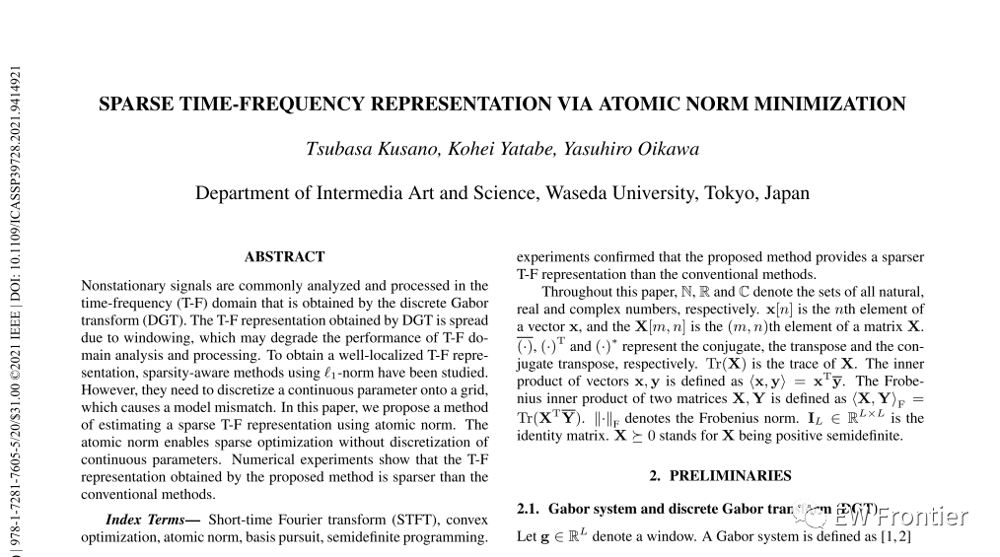
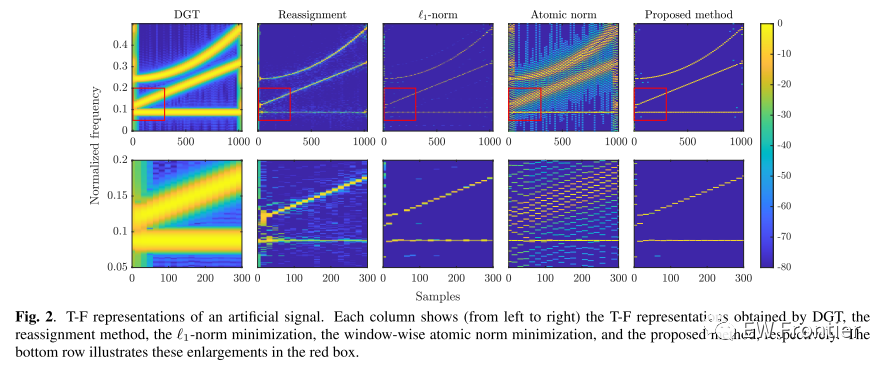
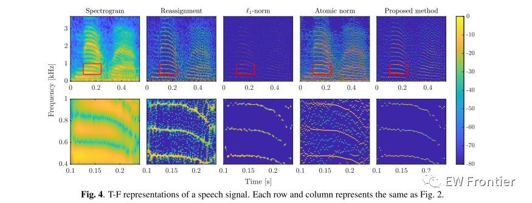

# Time-Frequency Analysis: Sparse Time-Frequency Representation Based on Atomic Mode Minimization [with MATLAB Code]

Abstract:
Non-stationary signals are often analyzed and processed in the time-frequency domain, which is achieved through Discrete Gabor Transform (DGT). Due to the effect of windowing, the T-F representations obtained from DGT tend to expand, thereby degrading the performance of analysis and processing in the T-F domain. To achieve good localized T-F representations, sparse perception methods using N1-norm have been studied. However, they require discretizing continuous parameters onto a grid, which can lead to model mismatch. In this paper, we propose an approach to estimate sparse T-F representations using atomic norms. Atomic norms enable sparse optimization without the need for continuous parameter discretization. Numerical experiments show that the T-F representations obtained by this method are more sparse than traditional methods.
Index terms - Short Time Fourier Transform (STFT), Convex Optimization, Atomic Norm, Basis Pursuit, Semidefinite Programming.
1. Introduction:
Non-stationary signals are typically analyzed and processed in the time-frequency domain (T-F). To convert the time-domain signal into the T-F domain, Short Time Fourier Transform (STFT) or Discrete Gabor Transform (DGT) is commonly used, due to their simple and intuitive structure [1,2]. However, the T-F representations obtained from it may expand due to the analysis signal's windowing. This expansion can affect the performance of T-F domain analysis and processing.
To achieve good localized T-F representations, many methods have been proposed [3-14]. Redistribution and synchronization compression methods aim to relocate extended components back to their original positions using phase derivative information [3-6]. Their performance is affected by component mixing due to windowing [15]. Sparse perception methods are powerful tools that can resist such component and noise mixing [7-14]. The goal of sparse perception methods is to find the sparse solution of an underdetermined system. However, typical formulations involve minimizing 1-norm with discrete parameters discretized onto a grid. Due to model mismatch between the signal and the predefined grid, it can reduce performance [16].
1. Recent research on sparse optimization using atomic norms [17-20] has been applied to many applications, such as line spectrum estimation [21, 22], direction of arrival estimation [23-25], and target localization in radar systems [26]. Atomic norms do not require the discretization of continuous parameters. Therefore, introducing atomic norms into sparse T-F representations can lead to better localized T-F representations. In this paper, we propose a sparse TF representation for an estimation method. In the proposed method, the estimation problem is formulated as analyzing time-domain signals that can be reconstructed under the condition of minimizing atomic norms. Experiments confirm that the proposed method provides a more sparse T-F representation than traditional methods.
2. Simulation results  
T-F representations of artificial signals. Each column (from left to right) shows the T-F representations obtained through DGT, reassignment method, W1-norm minimization, window atomic norm minimization, and the proposed method. The next row in red frames indicates these enlarged images.
MATLAB code section
%% parameter\na = 2^4; \nwindowLen = 2^7; \nbw = 0.04; \ng = dpss(windowLen, bw*windowLen/2, 1); \n​\n%% artifical signal\nL = 2^10; \nt = (0:L-1)'; \n​\nx1 = sin(2*pi*(90/L)*t); \nx2 = chirp(t, 120/L, L-1, 330/L); \nx3 = chirp(t, 250/L, L-1, 500/L,'quadratic'); \nX = [x1, x2, x3]; \n​\ns = sum(X,2); \nf = Padding(s, a); \n​\n%% Estimate T-F representation\nrho = 0.01; \n[T, X, nu] = sparseTFR_ANM(f, g, a, rho); \n​\n%% Display the estimated T-F representation\nmin_dB = 60; \nfigure('Position', [900 766 960 320])\n​\nsubplot(1,2,1)\nc = dgt(f, calcCanonicalDualWindow(g, a), a, 2^10); \nimagesc([0, L-1], [0, 1], 20*log10(abs(c)./max(abs(c), [], 'all')))\naxis xy\nxlabel('Samples')\nylim([0, 0.5])\nylabel('Normalized frequency')\ncaxis([-min_dB, 0])\ncolorbar\ntitle('DGT')\n​\nsubplot(1,2,2)\ndisplay_ANMSpec(gca, T, X, a, min_dB, 1)\nxlabel('Samples')\nylabel('Normalized frequency')\ntitle('Proposed method')\n​\nset(gcf, 'InvertHardCopy', 'off')\n% saveas(gcf,'../results/ANMSpec.png')\n​\n​\n%% Padding function for periodicity\nfunction y = Padding(x, shiftLen)\nsigLen = length(x); \npaddingLen = ceil(sigLen/shiftLen)*shiftLen - sigLen; \ny = [x; zeros(paddingLen, 1)]; \nend\n​\n%% Discrete Gabor transform\nfunction c = dgt(f, g, a, M)\nN = length(f)/a; \nind = mod((0:N-1)*a + (0:length(g)-1)' - floor(length(g)/2), length(f)) + 1; \nc = fft(f(ind).*g, M); \nend\n\tAll code:

## Images

<!-- PAYMENT_BLOCK -->

## Get this dataset

- Payment link (Stripe): [Buy now](https://buy.stripe.com/3cs8yP7sY87d0vu9AB)
- Payment QR code: 

<!-- /PAYMENT_BLOCK -->
